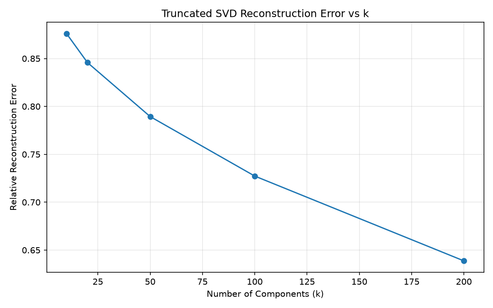
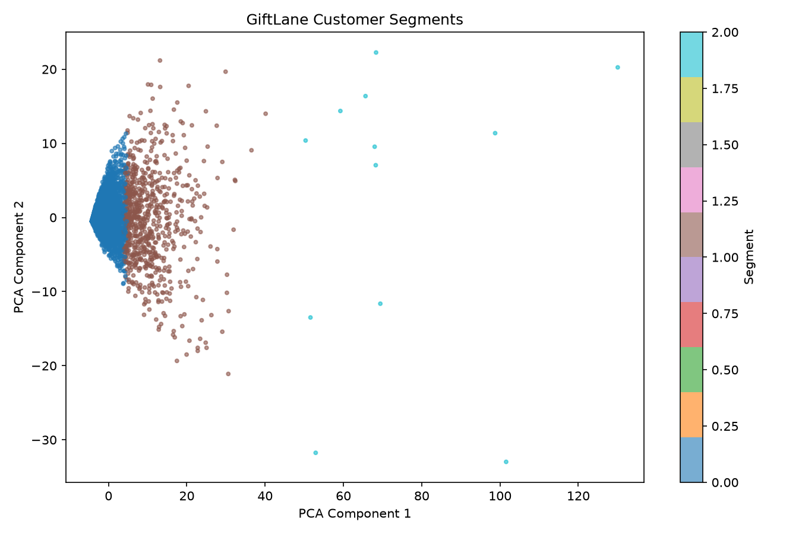

# MiniProject_LinearAlgebra

## Customers Like You — PCA or SVD for a Real Retail Problem

This project uses the UCI Online Retail II dataset to build a product recommendation system and analyze customer purchasing patterns for GiftLane, a fictional online retailer.

Truncated SVD is the primary dimensionality reduction method, with PCA used for comparison.

## Project Objectives and Success Targets

The project aims to:

- Build a clean customer-product matrix from retail transactions.
- Reduce the dimensionality of customer purchasing data using PCA or SVD.
- Recommend 10 previously unpurchased products to each customer.
- Evaluate recommendations on the final two months of transactions and compare Hit Rate@10 with a best-seller baseline.
- Compare PCA and SVD using model fit time, memory, stored factor size, explained variance, and recommendation accuracy.
- Identify 3–6 customer segments based on purchasing patterns.
- Make the data processing pipeline reproducible.

### Key Results

| Metric | Result |
|---|---:|
| Cleaned transactions | 802,920 |
| Customer-product matrix | 5,475 × 3,689 |
| Matrix sparsity | 97.95% |
| CSR storage reduction vs. dense | 96.91% |
| Best-seller Hit Rate@10 | 17.41% |
| SVD k=50 (Log) Hit Rate@10 | 37.32% |
| SVD k=100 (Log) Hit Rate@10 | 38.06% |
| Best tested Hit Rate@10 (Binary, k=50) | 40.15% |
| Customer segments | 3 |

## Dataset

**Source:** [UCI Online Retail II](https://archive.ics.uci.edu/dataset/502/online+retail+ii)

**Period:** December 2009 – December 2011

The original dataset contains 1,067,371 transaction rows across two Excel sheets, with 5,942 unique customers and 5,305 unique product codes.

Raw data is stored locally in `data/raw/` and excluded from Git.

## Data Engineering (DE1–DE6)

### Data Cleaning

The dataset was cleaned by removing cancelled invoices, non-positive quantities and prices, selected non-product stock codes, and transactions with missing customer IDs.

| Cleaning Rule | Rows Removed |
|---|---:|
| Cancelled Invoices | 19,494 |
| Non-positive Quantity | 3,457 |
| Non-positive Price | 2,750 |
| Non-product Stock Codes | 2,860 |
| Missing Customer ID | 235,890 |
| **Total Removed** | **264,451** |

**Final cleaned dataset:** 802,920 rows.

Detailed cleaning decisions are documented in `Cleaning_decisions.md`.

### Train/Test Split

The final two calendar months were reserved for testing.

- **Training:** 684,312 transaction rows
- **Test period:** 118,608 transaction rows
- **Held-out new-product purchases:** 56,919 transaction rows
- **Training customers:** 5,475

Held-out purchases include products that each customer had not purchased during the training period. Only existing training customers were retained for evaluation.

The customer-product matrix and recommendation models use training data only.

### Customer-Product Matrix

A sparse customer-product matrix was created from the training data.

- Rows represent customers.
- Columns represent products.
- Values represent `log(1 + total purchased quantity)`.
- Products purchased by fewer than 10 unique customers were excluded.

| Metric | Value |
|---|---:|
| Customers | 5,475 |
| Products | 3,689 |
| Non-zero entries | 413,983 |
| Sparsity | 97.95% |
| Dense storage | 154.09 MiB |
| CSR sparse storage | 4.76 MiB |
| Storage reduction | 96.91% |

Log transformation was used to reduce the influence of unusually large purchases.

CSR sparse storage was selected because most customer-product combinations have zero purchases.

### Reproducible Data Pipeline

The following command runs data cleaning, chronological splitting, and sparse matrix construction:

```bash
python build_matrix.py
```

The matrix statistics report can then be generated using:

```bash
python matrix_report.py
```

## Machine Learning Experiments (ML1–ML7)

### 1. Truncated SVD

Truncated SVD was selected because it can process sparse matrices without mean centering.

The model was trained using randomized SVD with 7 iterations and `random_state=42`.

| Components (k) | Explained Variance | Relative Reconstruction Error |
|---|---:|---:|
| 10 | 19.83% | 87.61% |
| 20 | 25.25% | 84.58% |
| 50 | 34.88% | 78.94% |
| 100 | 44.72% | 72.73% |
| 200 | 57.36% | 63.88% |

Larger values of k reduced reconstruction error, but did not always improve recommendation accuracy.



**Script:** `train_svd.py`

**Report:** `reports/svd_results.csv`

### 2. Product Recommendations

Two recommendation methods were implemented:

- **Truncated SVD:** Uses customer embeddings and product factors to estimate product preference scores.
- **Popularity Baseline:** Ranks products by total purchased quantity in the training data.

Both methods exclude products already purchased by the customer during training.

Cosine similarity between SVD product factors was also used to find the Top-10 most similar products.

**Script:** `recommend.py`

### 3. Recommendation Evaluation

Recommendations were evaluated against held-out purchases from the final two months.

- **Eligible evaluation customers:** 1,913
- **Unique evaluable customer-product pairs:** 44,729
- **Metrics:** Precision@10, Recall@10, Hit Rate@10

Hit Rate@10 measures the proportion of evaluated customers for whom at least one recommended product matches a held-out purchase.

| Model | Precision@10 | Recall@10 | Hit Rate@10 |
|---|---:|---:|---:|
| Popularity Baseline | 2.26% | 1.15% | 17.41% |
| SVD k=10 | 4.70% | 2.89% | 30.89% |
| SVD k=20 | 5.50% | 3.71% | 35.02% |
| **SVD k=50** | **6.13%** | 4.32% | 37.32% |
| SVD k=100 | 6.00% | **4.38%** | **38.06%** |

All tested SVD models outperformed the popularity baseline.

SVD k=50 achieved the highest Precision@10 among the original log-based SVD models, while k=100 achieved the highest Hit Rate@10.

### Recommendation Runtime

| Model | Generation Time |
|---|---:|
| Popularity Baseline | 0.6462 s |
| SVD k=10 | 0.9341 s |
| SVD k=20 | 0.8027 s |
| SVD k=50 | 0.8515 s |
| SVD k=100 | 0.8425 s |

**Total experimental recommendation job time:** 4.0873 seconds.

This measurement covers recommendation generation, related validation, and output handling for the tested models. It does not include data preprocessing or model training. Runtime may vary between runs.

**Scripts:** `recommend.py`, `evaluate.py`

**Reports:**
- `reports/evaluation_results.csv`
- `reports/recommendation_runtime.csv`

### 4. PCA vs. Truncated SVD

PCA and Truncated SVD were compared on the same training matrix using 50 components.

| Measure | PCA | Truncated SVD |
|---|---:|---:|
| Components | 50 | 50 |
| Fit time | 0.1021 s | 0.1057 s |
| Peak process memory | 207.92 MiB | 234.64 MiB |
| Stored factors | 3.524 MiB | 3.496 MiB |
| Explained variance | 34.93% | 34.88% |
| Hit Rate@10 | 37.27% | 37.32% |

Both methods showed similar recommendation accuracy.

Truncated SVD was retained as the primary method because it operates directly on sparse data without centering.

The memory measurements represent peak process memory, not memory exclusively allocated during model fitting.

**First Component:** Products with the largest absolute loadings included stock codes `21212`, `85123A`, `85099B`, `20725`, and `84991`. These prominent loadings may reflect common product purchasing patterns, although their specific meaning requires further interpretation.

**Scripts:** `compare_models.py`, `compare_pca_svd.py`

**Report:** `reports/pca_vs_svd.csv`

### 5. Customer Segmentation

K-Means clustering was applied to the 50-dimensional SVD customer embeddings.

The number of clusters was compared within the required range of 3–6 using sampled Silhouette Scores.

| Clusters | Silhouette Score |
|---|---:|
| **3** | **0.5253** |
| 4 | 0.3682 |
| 5 | 0.3288 |
| 6 | 0.3184 |

Three clusters achieved the highest score within the required range.

| Segment | Proposed Name | Customers | Percentage |
|---|---|---:|---:|
| 0 | Home & Giftware Buyers | 4,734 | 86.47% |
| 1 | Retrospot & Everyday Goods Buyers | 729 | 13.32% |
| 2 | Lunchware & Tableware Buyers | 12 | 0.22% |

**Segment 0:** Common products include White Hanging Heart T-Light Holder and Regency Cakestand 3 Tier. Top countries include the United Kingdom, Germany, and France.

**Segment 1:** Common products include Retrospot Cake Cases and Jumbo Bag Red Retrospot. Top countries include the United Kingdom, Germany, and France.

**Segment 2:** Common products include Red Spotty Bowl and Lunch Bag Red Retrospot. Top countries include the United Kingdom, EIRE, and Australia.

Segment names are descriptive rather than definitive. The clusters are highly imbalanced, and Segment 2 contains only 12 customers.



**Scripts:** `customer_segments.py`, `analyze_segments.py`

**Reports:**
- `reports/segment_profiles.csv`
- `reports/silhouette_results_final.csv`

### 6. Purchase Value Sensitivity Analysis

Three ways of representing purchases were compared using SVD with k=50.

- **Count:** Total purchased quantity
- **Binary:** 1 if purchased, otherwise 0
- **Log:** `log(1 + total purchased quantity)`

| Purchase Value | Hit Rate@10 | Precision@10 | Recall@10 |
|---|---:|---:|---:|
| Count | 21.12% | 2.68% | 1.69% |
| **Binary** | **40.15%** | **6.75%** | **4.66%** |
| Log | 37.32% | 6.13% | 4.32% |

Binary purchase values produced the highest recommendation accuracy among the tested representations.

This suggests that whether a product was purchased can be more useful for this recommendation task than the total quantity purchased.

**Script:** `sensitivity_analysis.py`

**Report:** `reports/sensitivity_results.csv`

## Limitations and Future Work

- **Cold-start:** New customers and products without training history cannot be fully evaluated by the current personalized recommendation approach.
- **Evaluation scope:** Recommendation accuracy is measured only for eligible customers and products represented in the training matrix.
- **Sparse data:** Low explained variance at smaller k values indicates that much of the original purchase variation is not captured.
- **Customer segmentation:** The clusters are imbalanced, and the 12-customer segment requires further investigation before marketing use.
- **Model selection:** Binary values achieved better recommendation accuracy than the original log representation. Further experiments could evaluate Binary across additional component counts.
- **Component interpretation:** Product descriptions and factor loadings should be examined further to explain the meaning of latent components.

## Installation and Reproduction

### 1. Clone the Repository

```bash
git clone https://github.com/chrismskim/MiniProject_LinearAlgebra.git
cd MiniProject_LinearAlgebra
```

### 2. Create a Virtual Environment

```bash
python -m venv miniproject
source miniproject/bin/activate
```

### 3. Install Dependencies

```bash
python -m pip install -r requirements.txt
```

### 4. Download the Dataset

Download [UCI Online Retail II](https://archive.ics.uci.edu/dataset/502/online+retail+ii) and place the Excel file at:

`data/raw/online_retail_II.xlsx`

### 5. Run the Project

Run the following commands from the project root:

```bash
python data_profile.py
python build_matrix.py
python matrix_report.py
python train_svd.py
python recommend.py
python evaluate.py
python compare_models.py
python compare_pca_svd.py
python customer_segments.py
python analyze_segments.py
python sensitivity_analysis.py
```

`build_matrix.py` automatically runs `data_cleaning.py` and `data_split.py` before creating the sparse matrix.

## Project Structure

| File / Directory | Description |
|---|---|
| `data_profile.py` | Data loading and profiling |
| `data_cleaning.py` | Transaction cleaning |
| `data_split.py` | Time-based train/test split |
| `build_matrix.py` | Sparse matrix construction and data pipeline |
| `matrix_report.py` | Matrix sparsity and memory analysis |
| `train_svd.py` | SVD training and reconstruction analysis |
| `recommend.py` | Top-10 recommendations and product similarity |
| `evaluate.py` | Recommendation evaluation |
| `compare_models.py` | SVD model selection |
| `compare_pca_svd.py` | PCA and SVD comparison |
| `customer_segments.py` | Initial clustering experiments |
| `analyze_segments.py` | Final segment profiling |
| `sensitivity_analysis.py` | Count, Binary, and Log comparison |
| `Cleaning_decisions.md` | Cleaning decision log |
| `Model_decisions.md` | Dimensionality reduction method selection |
| `reports/` | Generated results, tables, and figures |
| `data/processed/` | Local processed datasets, mappings, and models |

The `data/` directory and local virtual environment are excluded from Git.

## Data Citation

Chen, D. (2012). *Online Retail II* [Dataset]. UCI Machine Learning Repository.

https://doi.org/10.24432/C5CG6D

License: CC BY 4.0.

GiftLane is a fictional retailer used for this academic project.